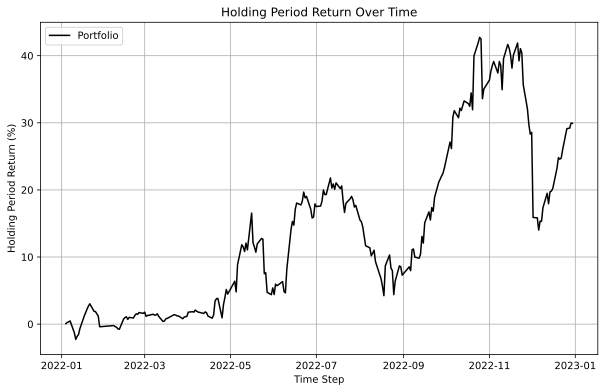
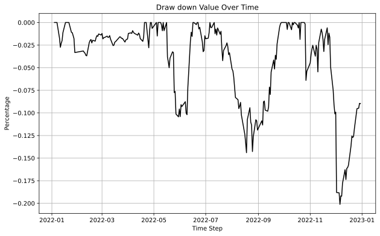
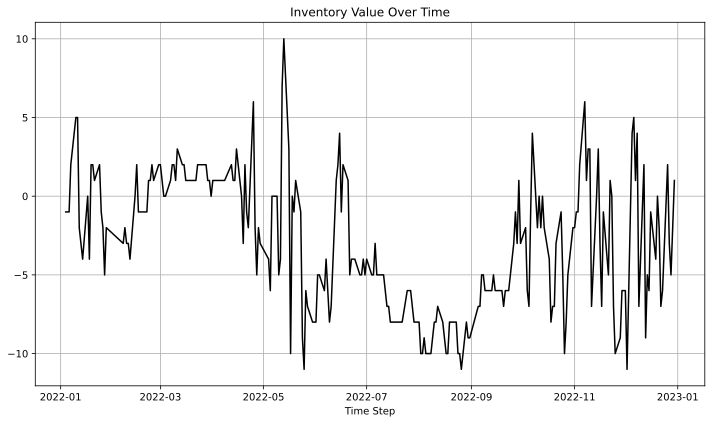
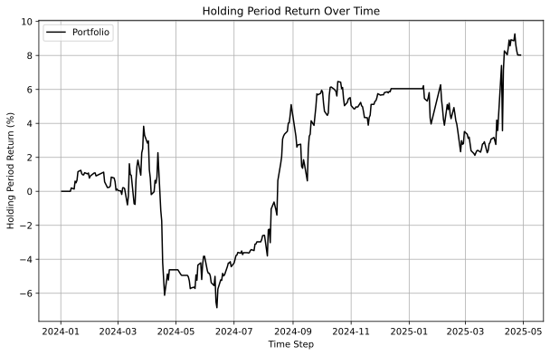
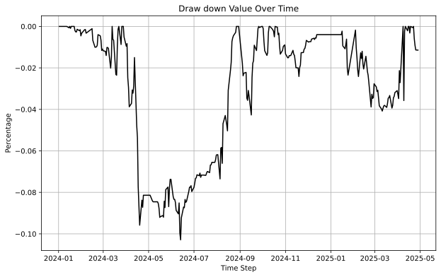
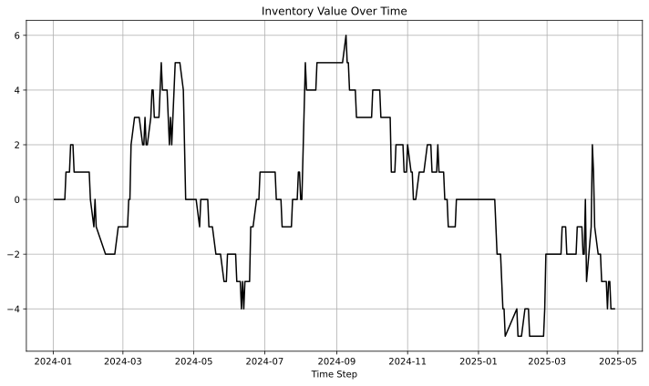

# PROTO:Market Maker
> Inventory-based two-sided quoting for VN30 index futures — place bid and ask limit orders skewed by current inventory.

## Abstract

PROTO:Market Maker is a market-making strategy for VN30 index futures that places simultaneous bid and ask limit orders sized and skewed by the maker's current inventory. Quote prices are recentered dynamically as the matched market price moves, using a configurable `step` distance that must exceed transaction fees plus slippage for the captured spread to be profitable. Quotes refresh every 15 seconds or whenever a resting order executes, and positions are carried overnight. The asset's valuation explicitly incorporates trading fees, forced-sale scenarios, and
contract expiration, so realized costs are not understated.

The strategy is developed and evaluated end-to-end on Algotrade VN30F1M / VN30F2M futures data (2022-01-01 to 2025-04-29) following the [9-step Development Process](https://www.algotrade.vn/knowledge/9-step-process/the-9-step) and the [Plutus Reproducibility Standard](https://github.com/algotrade-plutus/plutus-guideline). On the in-sample period (2022) it reaches a Sharpe of *0.95* and a *29.92%* holding-period return; on the out-of-sample period (2024-01-02 to 2025-04-29) it reaches a Sharpe of *0.08* and an *8.02%* holding-period return. Every reported number is reproducible in an isolated Docker container via `plutus-verify` against a committed groundtruth baseline (see [Implementation & Reproducibility](#implementation--reproducibility)).

## Introduction

Market making provides liquidity by continuously quoting both sides of the order book and earning the bid–ask spread. The central difficulty is *inventory risk*: when one side fills more than the other, the maker accumulates a directional position that adverse price moves can punish. A common remedy is to *skew quotes against inventory* — quoting more aggressively on the side that reduces the position — so the book naturally mean-reverts the maker's holdings while still capturing spread.

This project applies that idea to VN30 index futures: a two-sided, inventory-skewed quoting rule that recenters on the matched price and widens or tightens each side by the current inventory. The approach and its grounding in market-making practice follow the ALGOTRADE practitioner reference [1]. The sections below walk through the strategy under the PLUTUS Standard v2025 nine-step process.

## 1. Forming Algorithm Hypothesis

We hypothesize that inventory-aware two-sided quotes, recentered on the matched price, capture the bid–ask spread while keeping inventory bounded. Bid and ask prices are set as:

- $$bid = (price - step) - step * max(inventory, 0) * 0.02$$
- $$ask = (price + step) - step * min(inventory, 0) * 0.02$$

where `price` is the latest matched price, `step` is the base quote distance, and `inventory` is the signed position. The inventory term skews quotes to pull the position back toward zero. For the spread to be profitable, `step` must exceed the sum of transaction fee and slippage. Quotes are updated every 15 seconds or upon execution of a resting order, and positions are held overnight.

## 2. Data Preparation

- **Source:** Algotrade database — VN30 index futures (VN30F1M and VN30F2M).
- **Period:** 2022-01-01 to 2025-04-29.
- **Fees:** each buy or sell side is charged 0.4 / 2.

Daily close price, bid, ask, and tick data are collected from the Algotrade database via SQL queries (script: `data_loader.py`) and stored under `data/is/` (in-sample) and `data/os/` (out-of-sample).

### Obtaining the data

**Option 1 — Download from Google Drive (Recommended; no database credentials needed).**
This is the recommended path: the prepared data is published on Google Drive, so you can reproduce every downstream step without any database access. Download directly from [Google Drive](https://drive.google.com/drive/folders/181d7JcfHilIvviLgEuaDt2VqwZLYnYUF?usp=sharing). Place the `data/` folder at the repository root so the pipeline resolves `data/is/...` and `data/os/...`:

```
data
├── is
│   ├── VN30F1M_data.csv
│   └── VN30F2M_data.csv
└── os
    ├── VN30F1M_data.csv
    └── VN30F2M_data.csv
```

**Option 2 — Collect from the database.** Configure database credentials (see [Environment setup](#environment-setup)) and run:

```bash
uv run pmm-load-data
```

Output is written to `data/is/` and `data/os/`.

## 3. Forming Set of Rules

From the hypothesis we derive the concrete trading rules applied in every backtest:

- **Two-sided quoting:** at each update, place one bid and one ask using the Step 1 formulas, sized from available capital and the tradeable-contract limits.
- **Inventory skew:** the `0.02` inventory coefficient pulls quotes against the current position, biasing fills toward inventory reduction.
- **Update cadence:** refresh quotes every 15 seconds, or immediately when a resting order executes.
- **Cost accounting:** apply the 0.4 / 2 per-side fee; forced-sale scenarios and contract expiration add fees into the asset's valuation so returns reflect realized costs.
- **Overnight holding:** positions are carried overnight.

### Evaluation Metrics

The rules are evaluated with the following metrics, which are also the `expected` values verified by `plutus check`:

- **Sharpe ratio (SR)** and **Sortino ratio (SoR)** — annualized, benchmarked against a **6% per-annum risk-free rate** (≈ 0.023% per day).
- **Maximum drawdown (MDD)**.
- Supporting return measures: **holding-period return (HPR)**, **monthly return**, and **annual return**.

## Implementation & Reproducibility

With the rules and metrics defined, the strategy can be run and reproduced. The pipeline is packaged as `proto_market_maker` with console-script entry points (`pmm-load-data`, `pmm-backtest`, `pmm-optimize`, `pmm-evaluate`); each step below shows its own command.

### Environment setup
#### Setup the virtual environment
```bash
uv sync     # create the env from the committed uv.lock
```

Dependencies are pinned by the committed `uv.lock` (currently on the latest major lines — pandas 3.x, numpy 2.x); `uv sync` restores them exactly.

#### Database credentials (Optional)
*Database credentials are only needed if you intend to re-run the data preparation step from the database(Step 2, Option 2).* You can skip this entirely otherwise — the recommended path downloads the prepared data from Google Drive (Step 2, Option 1), and `plutus check` plus all backtests work with that, no database access required.

To regenerate the data from the Algotrade database, copy `.env.example` to `.env` at the repo root and fill in the credentials:

```env
HOST=<host name or IP address>
PORT=<database port>
DATABASE=<database name>
USER_DB=<database user name>
PASSWORD=<database password>
```

### Reproducibility

This repo ships a `.plutus/manifest.yaml` declaring the environment, data sources, steps, and expected metrics. Reproduce every result in an isolated Docker container with [plutus-verify](https://github.com/algotrade-plutus/plutus-verify) **v0.5.0**, installed straight from the public release wheel — no build-from-source needed:

```bash
# Requires Docker running. `uv venv` provisions a suitable Python (>= 3.11)
# automatically — no system python/pyenv needed.
uv venv .plutus-venv && source .plutus-venv/bin/activate
uv pip install "plutus-verify[runner] @ https://github.com/algotrade-plutus/plutus-verify/releases/download/v0.5.0/plutus_verify-0.5.0-py3-none-any.whl"

plutus check .     # build -> run each step in-container -> compare vs baseline
```

The `[runner]` extra brings Docker, repo2docker, and gdown, so `plutus check` builds the image, downloads the dataset from the declared Google Drive source, installs this package, runs each step's console script in-container, then compares the produced metrics and charts against the committed baseline in `.plutus/expected/`. Exit code `0` = reproduced (within tolerance), `1` = partial, `2` = failed.

## 4. In-sample Backtesting

Specify the period and parameters in `parameter/backtesting_parameter.json`, then run:

```bash
uv run pmm-backtest
```

Charts are written to `result/backtest/`.

### In-sample result (2022-01-01 to 2023-01-01)

| Metric                 | Value   |
|------------------------|---------|
| Sharpe Ratio           | 0.9516  |
| Sortino Ratio          | 1.3490  |
| Maximum Drawdown (MDD) | -0.2010 |
| HPR (%)                | 29.92   |
| Monthly return (%)     | 1.81    |
| Annual return (%)      | 17.10   |

HPR chart — `result/backtest/hpr.svg`



Drawdown chart — `result/backtest/drawdown.svg`



Daily inventory — `result/backtest/inventory.svg`



## 5. Optimization

The optimization search space is configured in `parameter/optimization_parameter.json`; a fixed random seed makes the search reproducible. Run:

```bash
uv run pmm-optimize
```

The optimized parameters are written to `parameter/optimized_parameter.json`. With seed `2025`, the current optimum is:

```json
{
    "step": 3.1
}
```

## 6. Out-of-sample Backtesting

Using the optimized parameters from Step 5, evaluate on the out-of-sample period (parameters in `parameter/backtesting_parameter.json`):

```bash
uv run pmm-evaluate
```

`pmm-evaluate` reads `parameter/optimized_parameter.json`; charts are written to `result/optimization/`.

### Out-of-sample result (2024-01-02 to 2025-04-29)

| Metric                 | Value   |
|------------------------|---------|
| Sharpe Ratio           | 0.0815  |
| Sortino Ratio          | 0.1183  |
| Maximum Drawdown (MDD) | -0.1028 |
| HPR (%)                | 8.02    |
| Monthly return (%)     | 0.57    |
| Annual return (%)      | 6.21    |

HPR chart — `result/optimization/hpr.svg`



Drawdown chart — `result/optimization/drawdown.svg`



Daily inventory — `result/optimization/inventory.svg`



## Reference

[1] ALGOTRADE, Algorithmic Trading Theory and Practice - A Practical Guide with Applications on the Vietnamese Stock Market, 1st ed. DIMI BOOK, 2023, pp. 52–53. Accessed: May 12, 2025. [Online]. Available: [Link](https://hub.algotrade.vn/knowledge-hub/market-making-strategy/)

## RIVF'26: naive vs faithful execution (branch `rivf26`)

**Hypothesis.** The same quoting signal, `strategy.quote(price, inventory, step)` at `step = 3.1`, fills far less and earns less once
execution is simulated faithfully (queue position, dated margin, exchange phases), and stops trading where the margin rule in force
cannot be sourced. MM is an execution-fidelity demonstrator: Tier-1 counters are the headline, P&L is Tier-2.

**Modelling choices.**
- One signal, two arms. The naive arm is this repo's engine (`backtest.py`, now calling `strategy.quote`): a quote fills when the
  last trade crosses it, capacity is a flat 17% margin, inventory is carried overnight. Its internal units are thousand đồng with a
  100/point multiplier; results are reported ×1000 in real đồng.
- The faithful arm (`experiments/mm_anchor.py`) drives `plutus.execution.PlutusBackend` over an `ExchangeSession` (HNXDS, tick
  resolution, `BookSessionSource` = daily bands + L2 depth 1–3 + sized tape). Real đồng: a 500,000,000đ derivatives deposit and the
  real VN30F multiplier of 100,000đ/point. The dated VSD initial margin comes from `plutus.market.margin.vsd_initial_margin` (13%
  before 2022-12-15, 17% from it). Fills come from `book_walk` under the `conservative` queue (headline) and the `optimistic` queue
  (bound). A third arm, `conservative_untaped`, replays the engine as it was before plutus-simulator `e528633`, when conservative
  taker sweeps had no prints and were always INDETERMINATE.
- Cadence: requote on each print when 15 s have passed since the last timed requote, or right after a fill. Requotes are
  cancel-and-replace, one contract per side. Quoting runs 09:00–14:25. Each session is then closed out with a marketable LIMIT
  priced 1 point through the touch until 14:29:59. Anything left open is marked at that day's close by the harness and counted
  (`closeout_marked_contracts`). The next session opens flat with the previous session's equity as its deposit.
- Regime guard (S6): before each session the strategy asks the dated rulebook for `margin_model()`. From the 2025-05-05 KRX cutover
  that call raises `UnresolvedRule`, because the post-trade COMS formula is unsourced, so the strategy refuses to quote rather than
  invent a margin rule. A diagnostic with the guard off is kept in `post_cutover_unguarded_diagnostic`.
- Contract per day: VN30F1M, or VN30F2M on the naive engine's roll session, mapped to the dated contract via `futurecontractcode`.
- Prices are index points; 1 point = 100,000đ per contract.

**Windows, and why they are the minimum.** There is no look-back, so no warm-up is needed. Each window is 20 sessions on each side
of one dated rule change, the floor of the handoff's 20–30.
- `krx2025` (primary): 2025-04-01 .. 2025-05-30, around the KRX cutover. Book and tape come from the Algotrade DB (sizes exist from
  2023).
- `im2022` (robustness): 2022-11-17 .. 2023-01-12, around the 13% → 17% IM step. Book and tape come from the local archive (the DB
  has no sizes before 2023); daily bands come from the DB.

Details, sizes and sha256 are in `data/<window>-MANIFEST.md`.

**Results** (`result/mm_anchor/<window>.json`, plutus-simulator `fc94743`):

| window | naive fills | faithful fills: conservative / optimistic / untaped | f/n (cons.) | HPR naive → faithful (cons.) |
|---|--:|--:|--:|--:|
| krx2025, all 40 sessions | 693 | 116 / 160 / 21 | 16.7% | +29.57% → −6.03% |
| krx2025, the 20 pre-cutover sessions (like-for-like) | 228 | 116 / 160 / 21 | 50.9% | −5.22% → −6.03% |
| im2022 | 129 | 70 / 98 / 6 | 54.3% | −12.93% → +2.19% |

The queue spread (conservative vs optimistic) is 27.5% in krx2025 and 28.6% in im2022. The conservative arm's maker quotes rest
about 3.1 points (31 ticks) away, beyond the three observed levels, so the queue ahead of them cannot be read. That leaves 99.8%
(krx2025) and 99.9% (im2022) of accepted orders INDETERMINATE at least once (`book_size`).

Dated-IM capacity on the same 500,000,000đ deposit at 1,059 points is 36 contracts at 13% and 27 at 17%. In the run itself
capacity was 36 on 2022-12-14 and 28 on 2022-12-15.

Post-cutover, the strategy refused all 20 of 20 sessions.

**Regenerate.**

```bash
# extraction (needs the plutus-simulator checkout + its venv + DB access; writes rivf26/data and data/)
.venv/bin/python -m proto_market_maker.experiments.extract_slices krx2025
.venv/bin/python -m proto_market_maker.experiments.extract_slices im2022
# runs (shipped data only; ~1 h each)
.venv/bin/python -m proto_market_maker.experiments.mm_anchor krx2025
.venv/bin/python -m proto_market_maker.experiments.mm_anchor im2022
.venv/bin/python -m pytest -q
```

### Attribution ladder (algorithm A fixed)

**Framing.** The naive engine's behaviour *is* the algorithm A under study; the naive engine (N) and Plutus (F) are
environments. A is: the merged F1/F2 rows naive iterates, `quote(price, inventory, 3.1)` on the row price, requote every 15 s or
after a fill, inventory carried overnight, the naive F1→F2 roll on the session before expiry. Every rung keeps A fixed and
changes one environment rule.

- **N0** naive as-is. **N1** + own-price fills (a crossed quote books at the bid/ask, not at the crossing print).
  **N2** + dated VSD IM (13% before 2022-12-15, 17% from it). **N3** + fee on every fill. These are opt-in options on
  `naive_variants.NaiveVariant`; `backtest.py` is unchanged and plutus-free.
- **F-opt / F-con**: `experiments/mm_faithful_a.py` runs A in **one multi-day `ExchangeSession`** (`book_walk`,
  optimistic / conservative queue).
  - The session clock steps on naive's own rows; quotes run 09:00–14:30:59, so quotes resting at 14:30 meet the ATC
    under the engine's rules.
  - Inventory is carried: the engine settles VM daily, applies the dated IM, runs the margin ladder and executes forced
    closes. Naive's `handle_force_sell` is not ported.
  - On naive's roll trigger A sends real orders that close F1 and open the same signed position in F2. These are
    marketable LIMITs 1 point through the touch. A refused or unfilled leg is resubmitted on every 15 s requote tick until
    it is done or the session ends.
  - P&L is the harness's own ledger (fills, expiry settlements, close marks, engine charges); the engine deposit is
    recorded beside it and now agrees with it to 0đ.
  - `mm_anchor.py` and `result/mm_anchor/*` are untouched.
- **Data.** On every day A holds or trades a contract, everything F reads for that contract is in the slice
  (`extract_slices.touched`):
  - Bands: both VN30F1M and VN30F2M on every session.
  - Book (depth 1–3 with sizes) and sized tape: the traded contract, plus both contracts on roll days and on the session
    after a roll.
  - See `data/<window>-MANIFEST.md`.
- krx2025 is compared on the 20 pre-cutover sessions. F runs all 40; A has no guard, so the post-cutover sessions are
  reported separately.

#### im2022 (all 40 sessions)

| rung | environment | fills | Δ fills | round trips | HPR | Δ HPR | undecided orders |
|---|---|--:|--:|--:|--:|--:|--:|
| N0 | naive as-is | 129 |  | 64 | -12.93% |  |  |
| N1 | + own-price fills | 129 | +0 | 64 | -15.90% | -2.97 pp |  |
| N2 | + dated VSD IM (13% / 17%) | 129 | +0 | 64 | -15.90% | +0.00 pp |  |
| N3 | + fee on every fill | 129 | +0 | 64 | -16.42% | -0.52 pp |  |
| F-opt | Plutus faithful-A, optimistic queue | 198 | +69 | 99 | -2.52% | +13.90 pp | 0.04% |
| F-con | Plutus faithful-A, conservative queue | 116 | -82 | 57 | -11.47% | -8.94 pp | 99.88% |

Cross-check checkpoint: through 2022-12-13 (19 sessions), the last session before the first non-empty roll (every roll completed) (2022-12-14):

| rung | fills | Δ fills | round trips | HPR | Δ HPR |
|---|--:|--:|--:|--:|--:|
| N0 | 104 |  | 50 | -17.98% |  |
| N1 | 104 | +0 | 50 | -19.95% | -1.97 pp |
| N2 | 104 | +0 | 50 | -19.95% | +0.00 pp |
| N3 | 104 | +0 | 50 | -20.38% | -0.43 pp |
| F-opt | 116 | +12 | 53 | -14.03% | +6.35 pp |
| F-con | 72 | -44 | 33 | -15.70% | -1.67 pp |

Faithful-A Tier-1 (same span):

| | margin warnings | margin calls | forced liq. (executed) | VM settlement days | roll fills / roll legs | roll retries | roll unfilled | engine (forced) fills | max abs(ledger − engine deposit) |
|---|--:|--:|--:|--:|--:|--:|--:|--:|--:|
| F-opt | 0 | 0 | 0 (0) | 38 | 20 / 20 | 3 | 0 | 0 | 0đ |
| F-con | 0 | 0 | 0 (0) | 40 | 12 / 12 | 5 | 0 | 0 | 0đ |

F-opt: `result/mm_faithful_a/im2022_optimistic.json` sha256 `d1e4c02f63552cf7…`, plutus-simulator `b52877e` (checkout moved to `af55e29` before the run ended)
F-con: `result/mm_faithful_a/im2022_conservative.json` sha256 `dbd6104fc1d0ed2a…`, plutus-simulator `b52877e` (checkout moved to `af55e29` before the run ended)

#### krx2025 (20 pre-cutover sessions)

| rung | environment | fills | Δ fills | round trips | HPR | Δ HPR | undecided orders |
|---|---|--:|--:|--:|--:|--:|--:|
| N0 | naive as-is | 228 |  | 112 | -5.22% |  |  |
| N1 | + own-price fills | 228 | +0 | 112 | -14.09% | -8.88 pp |  |
| N2 | + dated VSD IM (13% / 17%) | 228 | +0 | 112 | -14.09% | +0.00 pp |  |
| N3 | + fee on every fill | 228 | +0 | 112 | -15.02% | -0.93 pp |  |
| F-opt | Plutus faithful-A, optimistic queue | 261 | +33 | 127 | -7.58% | +7.45 pp | 0.08% |
| F-con | Plutus faithful-A, conservative queue | 153 | -108 | 71 | -25.55% | -17.97 pp | 99.63% |

Cross-check checkpoint: through 2025-04-15 (10 sessions), the last session before the first non-empty roll (every roll completed) (2025-04-16):

| rung | fills | Δ fills | round trips | HPR | Δ HPR |
|---|--:|--:|--:|--:|--:|
| N0 | 179 |  | 88 | -7.15% |  |
| N1 | 179 | +0 | 88 | -14.96% | -7.81 pp |
| N2 | 179 | +0 | 88 | -14.96% | +0.00 pp |
| N3 | 179 | +0 | 88 | -15.69% | -0.73 pp |
| F-opt | 197 | +18 | 93 | +4.49% | +20.18 pp |
| F-con | 113 | -84 | 53 | -26.25% | -30.73 pp |

Faithful-A Tier-1 (same span):

| | margin warnings | margin calls | forced liq. (executed) | VM settlement days | roll fills / roll legs | roll retries | roll unfilled | engine (forced) fills | max abs(ledger − engine deposit) |
|---|--:|--:|--:|--:|--:|--:|--:|--:|--:|
| F-opt | 1 | 1 | 0 (0) | 18 | 22 / 22 | 4 | 0 | 0 | 0đ |
| F-con | 4 | 0 | 0 (0) | 18 | 14 / 14 | 6 | 0 | 0 | 0đ |

krx2025 post-cutover (20 sessions, A unguarded):

- F-opt: fills 314, margin calls 7, forced liquidations 0 (0 executed), HPR over the post sessions -4.81%, whole 40 sessions -12.02%
- F-con: fills 259, margin calls 23, forced liquidations 18485 (3 executed), HPR over the post sessions -17.30%, whole 40 sessions -38.43%

F-opt: `result/mm_faithful_a/krx2025_optimistic.json` sha256 `ba3d87b6cd379cad…`, plutus-simulator `b52877e` (checkout moved to `af55e29` before the run ended)
F-con: `result/mm_faithful_a/krx2025_conservative.json` sha256 `d4466fcfd69d968b…`, plutus-simulator `b52877e` (checkout moved to `af55e29` before the run ended)

Reading (report, don't tune):
- **Does F < N hold on return for A?** Measured against naive as-is (N0):
  - **im2022: no.** Both F arms lose less than N0: F-opt −2.52% and F-con −11.47%, against −12.93%. It holds at the
    19-session checkpoint too (−14.03% and −15.70%, against −17.98%).
  - **krx2025 (pre-cutover): yes.** F-opt −7.58% and F-con −25.55%, against −5.22%.
  - **krx2025 at the 10-session checkpoint:** F-opt is +4.49% against −7.15%, the opposite direction to the full window.
    F-con, at −26.25%, agrees with the full window.
- **The im2022 reversal does not survive A with overnight carry.** The flat-each-session faithful arm made +2.2%; A in
  F loses in both queues. F still loses less than N.
- **The naive-side rungs:** own-price fills is the only one that moves anything (−2.97 pp im2022, −8.88 pp krx2025).
  The dated IM changes nothing in N, because N's capacity never binds. It does bind in F: there are
  `INSUFFICIENT_DEPOSIT` quote refusals in krx2025 (924 under conservative).
- **N3 → F is the largest step, and it depends on the queue.** Optimistic vs conservative differs by 8.9 pp (im2022)
  and 18 pp (krx2025; 31 pp at the checkpoint). The conservative queue leaves 99.6–99.9% of orders undecided. With carry,
  which quotes fill decides which side the inventory sits on through the April 2025 gaps.
- **Rolls now complete in every run:** 20/20, 12/12, 22/22 and 14/14 legs, after 3–6 retries.
- **krx2025 post-cutover, F-con:** 18,485 forced-liquidation events; 3 had a close accepted and 21 contracts were
  force-closed.

Regenerate (each faithful-A run takes about 17–36 min at plutus-simulator `b52877e`):

```bash
.venv/bin/python -m proto_market_maker.experiments.extract_slices im2022   # needs DB + archive
.venv/bin/python -m proto_market_maker.experiments.extract_slices krx2025  # needs DB
for w in im2022 krx2025; do for q in optimistic conservative; do
  .venv/bin/python -m proto_market_maker.experiments.mm_faithful_a $w --queue $q; done; done
.venv/bin/python -m proto_market_maker.experiments.mm_ladder im2022
.venv/bin/python -m proto_market_maker.experiments.mm_ladder krx2025
.venv/bin/python -m pytest -q tests/test_naive_variants.py tests/test_regression_baseline.py
```
