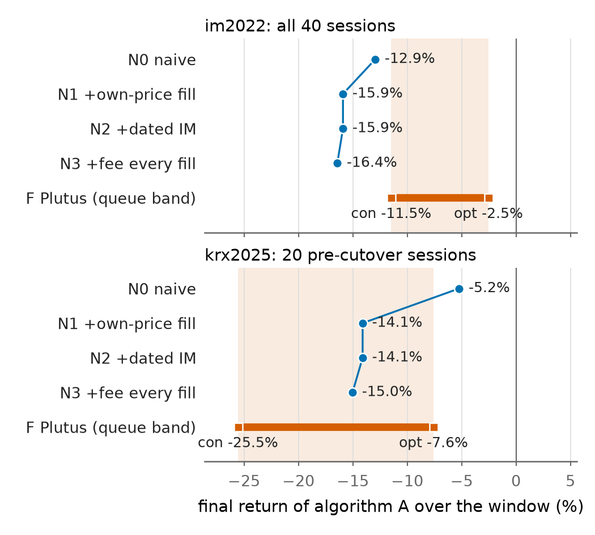

# MarketMaker under naive and faithful execution: preliminary report (RIVF'26)

Generated by `proto_market_maker.experiments.mm_report` from the result files at repo commit `cc19d78` (branch `rivf26`). Every number below is read from a result file; regenerate rather than edit. Status: **preliminary**; full-window markouts are pending where marked, and the faithful results predate the latest engine fixes (see Provenance).

Companion files: figure and tables in `result/paper_kit/` (README there); raw results in `result/mm_ladder/`, `result/mm_faithful_a/`, `result/mm_markout/`, `result/mm_anchor/`.

## 1. The question

Hold the algorithm fixed and change only the execution environment: how much of a market maker's backtest result is the algorithm, and how much is the simulator's fill assumptions?

**Algorithm A** is this repo's naive engine *behaviour*: the merged F1/F2 rows the naive engine iterates; `quote(price, inventory, 3.1)` on the row price (inventory-skewed bid/ask about 3.1 points from the last print); requote every 15 s or right after a fill; one contract per side; inventory carried overnight; the naive F1→F2 roll on the session before expiry. **The naive engine (N) and Plutus (F) are environments.** Each ladder rung keeps A fixed and changes one environment rule.

## 2. The environments

| rung | what it adds |
|---|---|
| N0 | the naive engine as-is: a quote fills when the last print crosses it and books at that print; flat 17% margin capacity; fee only on position-reducing fills |
| N1 | own-price fills: a crossed quote books at its own bid/ask, not at the crossing print |
| N2 | dated VSD initial margin for capacity: 13% before 2022-12-15, 17% from it |
| N3 | the fee on every fill, opening fills too |
| F-opt | Plutus faithful-A, `book_walk` with the optimistic queue (A is first at its price level) |
| F-con | Plutus faithful-A, `book_walk` with the conservative queue (A is behind everything displayed) |

N0..N3 are cumulative opt-in options on `naive_variants.NaiveVariant` (`backtest.py` is unchanged). F-opt / F-con run A in one multi-day Plutus `ExchangeSession` (`experiments/mm_faithful_a.py`): the engine settles variation margin daily, applies the dated VSD IM, runs the margin ladder and executes forced closes; A's roll is sent as real orders; quotes resting at 14:30 meet the closing auction under the engine's rules; P&L is the harness ledger in real đồng (500,000,000 đ deposit, 100,000 đ per index point), cross-checked against the engine deposit.

Windows: `im2022`, 20 sessions either side of the 2022-12-15 VSD IM step (13% → 17%; book from the local archive), and `krx2025`, 20 sessions either side of the 2025-05-05 KRX cutover (book from the Algotrade DB). The krx2025 ladder compares the 20 pre-cutover sessions; the post-cutover sessions are reported apart. Slices and sha256: `data/<window>-MANIFEST.md`.

## 3. Results: the ladder



Figure: final return per environment; the shaded band is the faithful queue band F-con..F-opt (`result/paper_kit/mm_ladder.pdf`).

### im2022 (all 40 sessions, 40 sessions: 2022-11-17 .. 2023-01-12)

| rung | environment | fills | Δ fills | round trips | return (HPR) | Δ HPR | max drawdown | undecided orders |
|---|---|--:|--:|--:|--:|--:|--:|--:|
| N0 | naive as-is | 129 |  | 64 | -12.93% |  | -23.48% |  |
| N1 | + own-price fills | 129 | +0 | 64 | -15.90% | -2.97 pp | -24.44% |  |
| N2 | + dated VSD IM (13% / 17%) | 129 | +0 | 64 | -15.90% | +0.00 pp | -24.44% |  |
| N3 | + fee on every fill | 129 | +0 | 64 | -16.42% | -0.52 pp | -24.60% |  |
| F-opt | Plutus faithful-A, optimistic queue | 198 | +69 | 99 | -2.52% | +13.90 pp | -32.18% | 0.04% |
| F-con | Plutus faithful-A, conservative queue | 116 | -82 | 57 | -11.47% | -8.94 pp | -27.54% | 99.88% |

- Range across the six environments: -16.42% .. -2.52% (13.90 pp), with A unchanged.
- Faithful queue band: -11.47% (F-con) .. -2.52% (F-opt), width 8.94 pp. Naive rungs outside it: N0, N1, N2, N3 (below it: N0, N1, N2, N3).

Cross-check before any roll: through 2022-12-13 (19 sessions; cut at the last session before the first non-empty roll (every roll completed), 2022-12-14). It shows whether the full-window ordering is a roll artefact.

| rung | fills | round trips | HPR | Δ HPR |
|---|--:|--:|--:|--:|
| N0 | 104 | 50 | -17.98% |  |
| N1 | 104 | 50 | -19.95% | -1.97 pp |
| N2 | 104 | 50 | -19.95% | +0.00 pp |
| N3 | 104 | 50 | -20.38% | -0.43 pp |
| F-opt | 116 | 53 | -14.03% | +6.35 pp |
| F-con | 72 | 33 | -15.70% | -1.67 pp |

Faithful-A Tier-1 counters (same span):

| arm | maker / taker fills | quote / roll / engine fills | margin warnings | margin calls | forced liq. (executed) | VM settlement days | roll fills / legs | roll retries | ledger − engine deposit (max abs) | positions match engine |
|---|--:|--:|--:|--:|--:|--:|--:|--:|--:|--:|
| F-opt | 69 / 129 | 178 / 20 / 0 | 0 | 0 | 0 (0) | 38 | 20 / 20 | 3 | 0 đ | yes |
| F-con | 10 / 106 | 104 / 12 / 0 | 0 | 0 | 0 (0) | 40 | 12 / 12 | 5 | 0 đ | yes |

N0 equals the `mm_anchor` naive arm (HPR and fills): yes.

Source: `result/mm_ladder/im2022.json` (sha256 `aa4c9551545099b8…`).

### krx2025 (20 pre-cutover sessions, 20 sessions: 2025-04-01 .. 2025-04-29)

| rung | environment | fills | Δ fills | round trips | return (HPR) | Δ HPR | max drawdown | undecided orders |
|---|---|--:|--:|--:|--:|--:|--:|--:|
| N0 | naive as-is | 228 |  | 112 | -5.22% |  | -7.71% |  |
| N1 | + own-price fills | 228 | +0 | 112 | -14.09% | -8.88 pp | -15.52% |  |
| N2 | + dated VSD IM (13% / 17%) | 228 | +0 | 112 | -14.09% | +0.00 pp | -15.52% |  |
| N3 | + fee on every fill | 228 | +0 | 112 | -15.02% | -0.93 pp | -16.25% |  |
| F-opt | Plutus faithful-A, optimistic queue | 261 | +33 | 127 | -7.58% | +7.45 pp | -13.79% | 0.08% |
| F-con | Plutus faithful-A, conservative queue | 153 | -108 | 71 | -25.55% | -17.97 pp | -27.64% | 99.63% |

- Range across the six environments: -25.55% .. -5.22% (20.33 pp), with A unchanged.
- Faithful queue band: -25.55% (F-con) .. -7.58% (F-opt), width 17.97 pp. Naive rungs outside it: N0 (above it: N0).

Cross-check before any roll: through 2025-04-15 (10 sessions; cut at the last session before the first non-empty roll (every roll completed), 2025-04-16). It shows whether the full-window ordering is a roll artefact.

| rung | fills | round trips | HPR | Δ HPR |
|---|--:|--:|--:|--:|
| N0 | 179 | 88 | -7.15% |  |
| N1 | 179 | 88 | -14.96% | -7.81 pp |
| N2 | 179 | 88 | -14.96% | +0.00 pp |
| N3 | 179 | 88 | -15.69% | -0.73 pp |
| F-opt | 197 | 93 | +4.49% | +20.18 pp |
| F-con | 113 | 53 | -26.25% | -30.73 pp |

Faithful-A Tier-1 counters (same span):

| arm | maker / taker fills | quote / roll / engine fills | margin warnings | margin calls | forced liq. (executed) | VM settlement days | roll fills / legs | roll retries | ledger − engine deposit (max abs) | positions match engine |
|---|--:|--:|--:|--:|--:|--:|--:|--:|--:|--:|
| F-opt | 89 / 172 | 239 / 22 / 0 | 1 | 1 | 0 (0) | 18 | 22 / 22 | 4 | 0 đ | yes |
| F-con | 23 / 130 | 139 / 14 / 0 | 4 | 0 | 0 (0) | 18 | 14 / 14 | 6 | 0 đ | yes |

Post-cutover sessions (A has no regime guard; reported apart from the ladder):

| arm | sessions | fills | margin calls | forced liq. (executed) | HPR over post sessions | HPR whole 40 |
|---|--:|--:|--:|--:|--:|--:|
| F-opt | 20 | 314 | 7 | 0 (0) | -4.81% | -12.02% |
| F-con | 20 | 259 | 23 | 18485 (3) | -17.30% | -38.43% |

N0 equals the `mm_anchor` naive arm (HPR and fills): yes.

Source: `result/mm_ladder/krx2025.json` (sha256 `d8ae7770b1d5e78e…`).

## 4. The queue band is a bound by construction

The optimistic queue puts A first at its price level; the conservative queue puts A behind every contract displayed at that level. Every real queue position lies between the two for the given data, so the faithful result for the data is bracketed by [F-con, F-opt] rather than given as one number. Caveat: the conservative arm cannot decide quotes resting beyond the three observed book levels (section 7), which weakens that side of the band.

- im2022: band -11.47% .. -2.52%; naive above it: none; below it: N0, N1, N2, N3.
- krx2025: band -25.55% .. -7.58%; naive above it: N0; below it: none.

Naive can fall outside the band in either direction: the sign of its bias is not fixed.

## 5. Why: adverse selection (markouts)

Markout of a fill at horizon h, per contract, in index points, + = good for A: `price(t+h) − fill` for a buy, `fill − price(t+h)` for a sell; price(t+h) is the last print of the contract filled (shipped tape), `close` the official close. The naive touch-fill rule fills A when the market runs through its quote, so naive fills are adversely selected by construction; faithful fills include taker fills (a quote that crosses the book) at a price at or better than the limit. A ghost-fill check reads the 1-minute markouts: a simulator that filled quotes the tape would not reach would show fills the market immediately moves through. Code: `experiments/mm_fills_trace.py`, `experiments/mm_markout.py`.

Note: an earlier throwaway analysis marked every fill against the F1 price. The first im2022 session (2022-11-17) is a roll day on which A quotes F2, so its numbers carried the F1/F2 basis on that day; the values here mark each fill against the contract filled and supersede it.

#### im2022: all 40 sessions, first 6 (price path: tape)

| arm | sessions | contracts | taker share | taker price improvement, median (pt) | markout 1 min | 5 min | close | P&L | carry | mark switch | trading | mean abs end inventory |
|---|--:|--:|--:|--:|--:|--:|--:|--:|--:|--:|--:|--:|
| N0 | 6 | 29 | 0% | n/a | -0.21 | -1.34 | +2.49 | +11.0M đ | +4.3M đ | +0.0M đ | +6.7M đ | 1.5 |
| N3 | 6 | 29 | 0% | n/a | -0.73 | -1.86 | +1.98 | +8.8M đ | +4.3M đ | +0.0M đ | +4.6M đ | 1.5 |
| F-opt | 6 | 39 | 59% | +0.40 | -0.54 | -0.92 | +3.68 | +20.2M đ | +6.3M đ | +0.0M đ | +13.9M đ | 2.5 |

Contracts by order role: N0 quote 29; N3 quote 29; F-opt unknown 39. (Naive roll legs are its book-keeping roll at the prints; the ladder's fill counts exclude them. Bare-list fill files carry no role: `unknown`.)
Fill contracts per session equal the equity source's own fill count: N0 yes, N3 yes, F-opt yes.
1-minute markouts: N0 -0.21 (negative), N3 -0.73 (negative), F-opt -0.54 (negative).

- F-opt: 39 fills carried no contract and were assigned one (0 ambiguous).
- Inputs: N0: naive trace run by `mm_markout`; N3: naive trace run by `mm_markout`; F-opt: `fills_opt6.json` (sha256 `7d953daec3f2b69f…`), equity from `result/mm_faithful_a/im2022_optimistic.json`.
- Source: `result/mm_markout/im2022_first6_markout.json` (sha256 `dfedf82b003239e1…`).

#### im2022: all 40 sessions (price path: tape)

| arm | sessions | contracts | taker share | taker price improvement, median (pt) | markout 1 min | 5 min | close | P&L | carry | mark switch | trading | mean abs end inventory |
|---|--:|--:|--:|--:|--:|--:|--:|--:|--:|--:|--:|--:|
| N0 | 40 | 137 | 0% | n/a | +0.61 | +0.38 | -0.58 | -64.7M đ | -55.3M đ | +1.0M đ | -10.4M đ | 3.2 |
| N3 | 40 | 137 | 0% | n/a | -0.47 | -0.71 | -1.66 | -82.1M đ | -55.3M đ | +1.0M đ | -27.9M đ | 3.2 |
| F-opt | 40 | 198 | 65% | +0.50 | +0.21 | +0.41 | +3.78 | -12.6M đ | -85.0M đ | +0.0M đ | +72.4M đ | 5.8 |
| F-con | 40 | 116 | 91% | +0.30 | -0.31 | -0.57 | +3.12 | -57.3M đ | -92.1M đ | +0.0M đ | +34.7M đ | 4.2 |

Contracts by order role: N0 quote 129, roll 8; N3 quote 129, roll 8; F-opt unknown 198; F-con unknown 116. (Naive roll legs are its book-keeping roll at the prints; the ladder's fill counts exclude them. Bare-list fill files carry no role: `unknown`.)
Fill contracts per session equal the equity source's own fill count: N0 yes, N3 yes, F-opt yes, F-con yes.
1-minute markouts: N0 +0.61 (not negative), N3 -0.47 (negative), F-opt +0.21 (not negative), F-con -0.31 (negative).

- F-opt: 180 fills carried no contract and were assigned one (3 ambiguous).
- F-con: 109 fills carried no contract and were assigned one (1 ambiguous).
- Inputs: N0: naive trace run by `mm_markout`; N3: naive trace run by `mm_markout`; F-opt: `fills_optimistic40.json` (sha256 `106887adb392315b…`), equity from `result/mm_faithful_a/im2022_optimistic.json`; F-con: `fills_conservative40.json` (sha256 `e99e702b773595ff…`), equity from `result/mm_faithful_a/im2022_conservative.json`.
- Source: `result/mm_markout/im2022_markout.json` (sha256 `445c24a3324fad61…`).

**krx2025 full-window markouts: PENDING** (needs the full-window fill traces of every arm; commands in the Reproduce section).

## 6. im2022: carry vs trading

Daily P&L split into carry (the previous session's end positions × the close-to-close move of each contract held) and trading (everything else: intraday fills, fees, the roll). This separates what A earned by quoting from what its overnight inventory earned or lost. Naive keeps one stitched F1/F2 position and marks it to F2 on its roll session, to the expiring F1 on expiry day and to the new F1 after; the basis in those revaluations is shown apart as mark switch (P&L = carry + mark switch + trading).

| arm | P&L | carry (overnight inventory × close-to-close move) | mark switch (naive F1/F2 stitch) | trading (the rest) | mean abs end inventory |
|---|--:|--:|--:|--:|--:|
| N0 | -64.7M đ | -55.3M đ | +1.0M đ | -10.4M đ | 3.2 |
| N3 | -82.1M đ | -55.3M đ | +1.0M đ | -27.9M đ | 3.2 |
| F-opt | -12.6M đ | -85.0M đ | +0.0M đ | +72.4M đ | 5.8 |
| F-con | -57.3M đ | -92.1M đ | +0.0M đ | +34.7M đ | 4.2 |

Source: `result/mm_markout/im2022_markout.json`.

## 7. Limits

- **No real fills.** The Algotrade desk's fill or slippage statistics are not available (R3.1 closed). Credibility rests on the queue band as a bound, the tape markouts, exact accounting (ledger = engine deposit), complete rolls and dated margin; no arm is claimed to be the truth.
- **Conservative queue undecided beyond the observed depth** (im2022): 99.88% of F-con's accepted orders were undecided at least once (F-opt: 0.04%). A quotes about 31 ticks from the last print, beyond the three book levels in the data, so the queue ahead is unobservable; owner decision: stay undecided, the band carries the result.
- **Conservative queue undecided beyond the observed depth** (krx2025): 99.63% of F-con's accepted orders were undecided at least once (F-opt: 0.08%). A quotes about 31 ticks from the last print, beyond the three book levels in the data, so the queue ahead is unobservable; owner decision: stay undecided, the band carries the result.
- **Post-KRX margin rule unsourced.** From 2025-05-05 the engine's `margin_model()` raises `UnresolvedRule`; the engine still admits derivatives orders, margins them on the pre-KRX shape and counts the blindness (`rule.margin_model.unsourced`: F-opt 269752, F-con 269733 evaluations). Post-cutover numbers are therefore not comparable and are reported apart.
- **The engine fixes listed under Provenance postdate the committed faithful results**; a rerun on the current engine may move the faithful numbers.
- **Sessions where the band has no ceiling/floor data** are recorded in `data/im2022-MANIFEST.md`.

## 8. Context: the earlier anchor (flat each session, regime guard on)

`mm_anchor` runs a different faithful arm (closes out every session, guard refuses post-KRX). Kept for the record; the ladder above is the A-fixed comparison.

| window | naive HPR (fills) | faithful conservative HPR (fills) | faithful optimistic HPR (fills) | conservative untaped HPR (fills) |
|---|--:|--:|--:|--:|
| im2022 | -12.93% (129) | +2.19% (70) | +2.21% (98) | +0.17% (6) |
| krx2025 | +29.57% (693) | -6.03% (116) | -13.59% (160) | +2.55% (21) |
| krx2025 (naive, pre-cutover only) | -5.22% (228) | | | |

## 9. Provenance

| result | sha256 | plutus-simulator commit | at end of run | src dirty | includes 67f18fa | includes dcaecb9 |
|---|---|---|---|---|---|---|
| `result/mm_faithful_a/im2022_conservative.json` | `dbd6104fc1d0` | `b52877e` | `af55e29` | no | no | no |
| `result/mm_faithful_a/im2022_optimistic.json` | `d1e4c02f6355` | `b52877e` | `af55e29` | no | no | no |
| `result/mm_faithful_a/krx2025_conservative.json` | `d4466fcfd69d` | `b52877e` | `af55e29` | no | no | no |
| `result/mm_faithful_a/krx2025_optimistic.json` | `ba3d87b6cd37` | `b52877e` | `af55e29` | no | no | no |
| `result/mm_anchor/im2022.json` | `4b3ed7b3af1c` | `fc94743` | `fc94743` | no | no | no |
| `result/mm_anchor/krx2025.json` | `f489b022ac0e` | `fc94743` | `fc94743` | no | no | no |
| `result/mm_ladder/im2022.json` | `aa4c95515450` | `af55e29` | `af55e29` | n/a | no | no |
| `result/mm_ladder/krx2025.json` | `d8ae7770b1d5` | `af55e29` | `af55e29` | n/a | no | no |
| `result/mm_markout/im2022_first6_markout.json` | `dfedf82b0032` | `e4c5f87` (head when assembled) | | n/a | see faithful inputs | see faithful inputs |
| `result/mm_markout/im2022_markout.json` | `445c24a3324f` | `e4c5f87` (head when assembled) | | n/a | see faithful inputs | see faithful inputs |

Engine fixes checked: `67f18fa` band-edge orders on book sessions decided from the book, not the daily bar; `dcaecb9` soft policy: market-order fills graded like a limit at the band edge (evidence label). "no" means the result predates the fix and the faithful numbers may move on a rerun. A ladder or markout row records the engine head when it was assembled; its faithful inputs carry their own commits (the `mm_faithful_a` rows). "includes" is judged on the commit at the end of the run.

## 10. Reproduce

All commands run from the repo root with the repo's `.venv` (plutus-simulator installed editable from its `rivf26` checkout) and read only the shipped `data/` slices.

```bash
# faithful-A runs (one per window x queue; long: log to a file)
.venv/bin/python -m proto_market_maker.experiments.mm_faithful_a im2022 --queue optimistic
.venv/bin/python -m proto_market_maker.experiments.mm_faithful_a im2022 --queue conservative
.venv/bin/python -m proto_market_maker.experiments.mm_faithful_a krx2025 --queue optimistic
.venv/bin/python -m proto_market_maker.experiments.mm_faithful_a krx2025 --queue conservative
# the ladder (naive rungs run here; faithful read from result/mm_faithful_a)
.venv/bin/python -m proto_market_maker.experiments.mm_ladder im2022
.venv/bin/python -m proto_market_maker.experiments.mm_ladder krx2025
# fill traces (faithful: minutes per session; --log is required, one line per session)
for W in im2022 krx2025; do for ARM in N0 N3 F-opt F-con; do
  .venv/bin/python -m proto_market_maker.experiments.mm_fills_trace $W --arm $ARM --log trace_${W}_${ARM}.log
done; done
# markouts (reads result/mm_markout/<window>_fills_<arm>.json; --fills ARM=PATH for other files)
.venv/bin/python -m proto_market_maker.experiments.mm_markout im2022
.venv/bin/python -m proto_market_maker.experiments.mm_markout krx2025
# figure and tables, then this report
.venv/bin/python -m proto_market_maker.experiments.mm_paper_kit
.venv/bin/python -m proto_market_maker.experiments.mm_report
.venv/bin/python -m pytest -q
```

## 11. Draft paragraph (not paper text; for the owner's decision)

> Holding a market-making algorithm fixed and changing only the execution environment moves its return from -2.5% to -16.4% (im2022) and from -5.2% to -25.5% (krx2025, pre-cutover): for a market maker the fill model is the P&L. The naive touch-fill rule is not uniformly flattering: it fills the algorithm as the market runs through its quote, which tape markouts show as adverse selection. Plutus reports a band bounded by the optimistic and conservative queue positions, which brackets every queue position the data allows, and the naive result can fall outside it in either direction.
